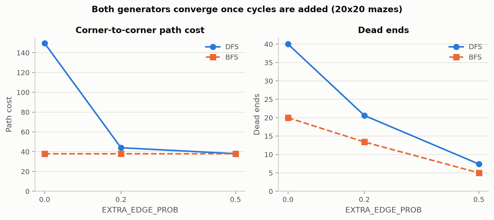
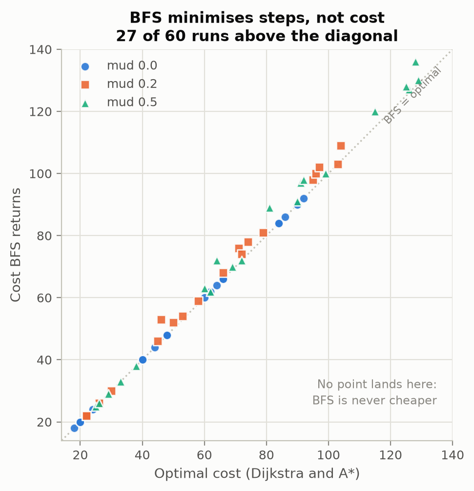
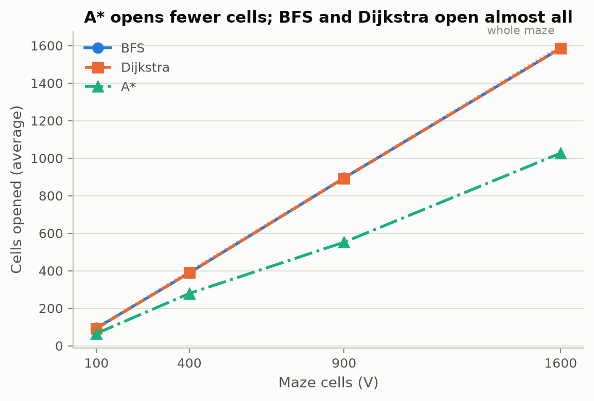
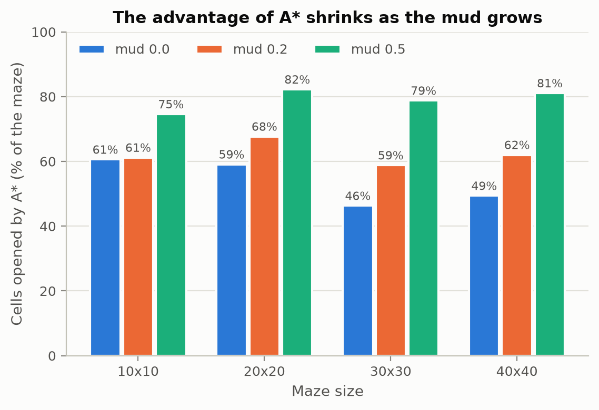
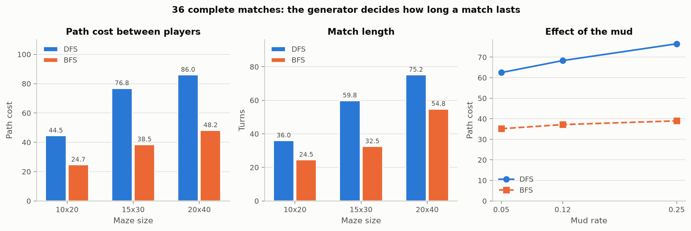
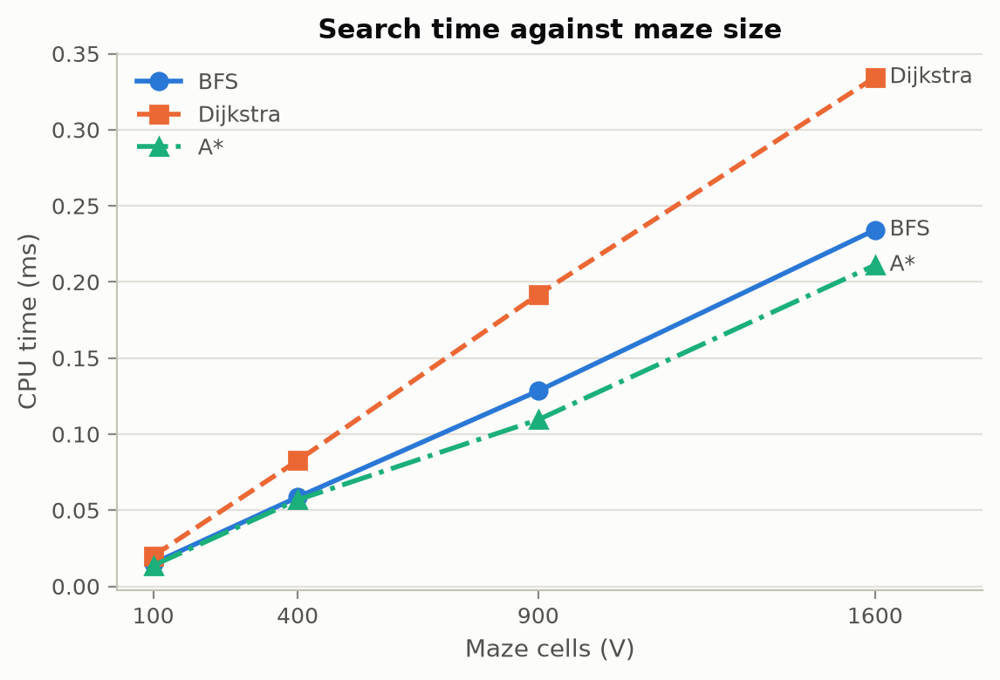
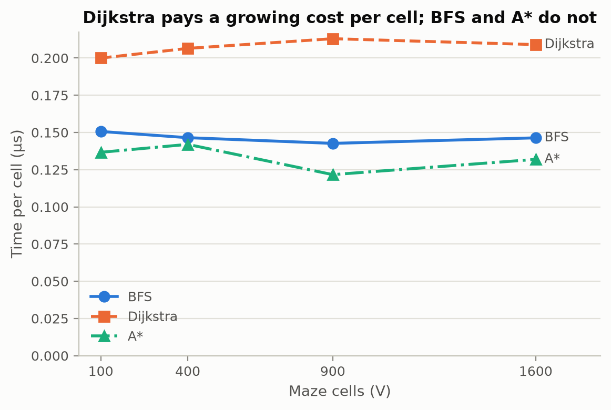

# Maze Craze: Experimental Report

### Authors: Alejandro Cubero, Kevin Velazques and Ashley Solano
### Course: Análisis de Algoritmos y Estructuras de Datos

## Methodology

Every measurement comes from the project's own instrumentation. `GenerationMetrics`
and `SearchMetrics` are filled inside each algorithm, and the CPU time is taken
with `std::clock` around the algorithm only, never around the interface, so the
figures exclude rendering and input. All the tools were compiled with `-O2`, so
the times describe the release behaviour of the algorithms.

Three data sets are used:

- `data/maze_comparison.csv`: 120 runs produced by `tools/MazeAnalysis.cpp`. Two
  generators (DFS and BFS), four square sizes (10x10, 20x20, 30x30 and 40x40),
  three values of `EXTRA_EDGE_PROB` (0.0, 0.2 and 0.5) and five seeds (42, 100,
  314, 7 and 2026). Both generators receive the same seed in each combination,
  so the comparison is paired.
- `data/path_comparison.csv`: 180 runs produced by `tools/PathComparison.cpp`.
  Three algorithms (BFS, Dijkstra and A\*) over the same mazes, with the same
  four sizes, mud rates of 0.0, 0.2 and 0.5 and the same five seeds. The three
  algorithms always run on an identical maze, so any difference comes from the
  algorithm and not from the map.
- `data/benchmark_results.csv`: 36 complete matches produced by
  `tools/BenchmarkRunner.cpp`. Three sizes (10x20, 15x30 and 20x40), three mud
  rates (0.05, 0.12 and 0.25), both generators and two repetitions of each
  combination, with the seeds listed in `data/seeds.txt`. Unlike the other two
  sets, these rows come from matches played to the end and not from isolated
  calls to the algorithms. Both players are automatic: player 1 follows the
  cheapest A\* path to the treasure, and player 2 is the same `AIController`
  the game uses, with its Jump Walls spent at random and its searches recorded
  in the engine. Running the tool twice gives the same file except for the CPU
  times, so every match is reproducible from its seed.

The four sizes give 100, 400, 900 and 1600 cells, a range of 16x that is wide
enough to observe how the cost of each algorithm grows. Mud cells cost
`MUD_COST = 2` to enter and normal cells cost 1. The cost of a path is the sum of
the entry cost of every cell it enters, without charging the starting cell.

Both tools measure the path between the two opposite corners of the maze, from
(0, 0) to (rows - 1, cols - 1), and not between the random starting rows that
`chooseStartPositions` produces during a real match. Fixed endpoints keep the
distance between the ends constant for a given size, so the differences between
the rows come from the algorithm and from the terrain alone. The path between the
two players is measured separately, on the complete matches of
`data/benchmark_results.csv`.

### Test environment

The three tools were compiled and run on the same machine, so the times of the
different tables are comparable with each other. The absolute times depend on
that machine and should not be compared with those of another one. What is
independent of the hardware, and what the conclusions of this report rest on, are
the ratios between algorithms and the way each measurement grows with the size of
the maze.

### Repetitions

Every combination of parameters is measured once. The average in the tables is
the average over the five seeds, not over repetitions of the same run. This is
enough for the conclusions about shape and growth, but it leaves the individual
times exposed to the noise of the operating system scheduler, as the outliers
section documents. Repeating each measurement and keeping the minimum is the
most direct improvement for a future run.

### Reproducing the data

The three CSV files and the seven figures are regenerated in full with:

```bash
cmake -S . -B build -DCMAKE_BUILD_TYPE=Release
cmake --build build --target MazeAnalysis PathComparison BenchmarkRunner
./build/MazeAnalysis        # writes data/maze_comparison.csv
./build/PathComparison      # writes data/path_comparison.csv
./build/BenchmarkRunner     # writes data/benchmark_results.csv
python3 tools/plots/make_plots.py --data-dir data --out-dir report/figures
```

## Maze Generation

### DFS against BFS

| Extra edge prob. | Algorithm | Dead ends | Path cost | Extra edges | CPU (ms) |
|---|---|---|---|---|---|
| 0.0 | DFS | 40.0 | 149.6 | 0 | 0.056 |
| 0.0 | BFS | 20.0 | 38.0 | 0 | 0.025 |
| 0.2 | DFS | 20.6 | 44.0 | 73.4 | 0.058 |
| 0.2 | BFS | 13.4 | 38.0 | 71.0 | 0.024 |
| 0.5 | DFS | 7.4 | 38.0 | 173.0 | 0.058 |
| 0.5 | BFS | 5.0 | 38.0 | 176.0 | 0.027 |

20x20 mazes, averages over the five seeds. A dead end is a cell with a single
accessible neighbour, that is, a cell entered and left through the same passage.

Both generators explore every cell of the maze and open exactly V - 1 passages
before the extra ones, which confirms that each produces a spanning tree: the
measured `createdEdges` equals `V - 1 + extraEdges` in all 120 runs.

The two generators differ sharply in the shape of the maze. Without extra
passages, the DFS maze forces a path of 149.6 cells on average between the two
corners, almost four times the 38 of the BFS maze, and it leaves twice as many
dead ends (40.0 against 20.0). This matches what the algorithms do: the
depth-first walk follows one corridor as far as it goes and only then backtracks,
which produces long winding corridors and many branches that end nowhere, while
the breadth-first walk expands in layers, so the path it leaves between two cells
is the shortest one the grid allows.

The BFS result is in fact exact, not approximate. In the 20 runs of the data set
its path cost is always 2(n - 1), the Manhattan distance between the two corners:
18, 38, 58 and 78 for the four sizes. A tree built by breadth-first search keeps
the distance of every cell to the root, so the corner-to-corner path can never be
longer than the grid distance.

`EXTRA_EDGE_PROB` erases that difference. At 0.2 the DFS path cost drops from
149.6 to 44.0, and at 0.5 both generators give exactly 38, the minimum possible.
Dead ends fall in both cases as well, from 40.0 to 7.4 in DFS and from 20.0 to
5.0 in BFS, because every extra passage can give a second neighbour to a cell
that had only one.



**Figure 1.** The two curves on the left meet as soon as cycles are added: the
DFS maze goes from 149.6 to 38 while the BFS one never leaves its minimum. The
right panel shows that dead ends fall in both generators, but the gap between
them holds. 20x20 mazes, averages over the five seeds.

In other words, the character of the generator is visible only while the maze is
close to a tree: once enough cycles are added, both converge to the same grid.

### Cells explored and time of the generation

| Size | Cells (V) | DFS cells explored | BFS cells explored | DFS CPU (ms) | BFS CPU (ms) |
|---|---|---|---|---|---|
| 10x10 | 100 | 100 | 100 | 0.0166 | 0.0072 |
| 20x20 | 400 | 400 | 400 | 0.0572 | 0.0251 |
| 30x30 | 900 | 900 | 900 | 0.1250 | 0.0521 |
| 40x40 | 1600 | 1600 | 1600 | 0.2225 | 0.0909 |

Cells explored and CPU time of the generation, averages over the five seeds and
the three extra edge probabilities.

The number of cells explored is identical for both generators and equals V
exactly, in all 120 runs of the data set. This is not a coincidence of the seeds
but a property of what the two algorithms do: both build a spanning tree, and a
spanning tree reaches every vertex by definition, so neither can finish having
left a cell unvisited nor can it visit one twice without closing a cycle. The
two generators therefore differ in the *shape* of what they build, as the
previous section measures, and not in how much of the maze they touch.

Because the work per cell is constant, the CPU time follows V directly. The
difference between the two columns is a constant factor of about 2.4 at every
size, which comes from the data structures each one uses and not from the number
of cells: the depth-first walk pushes and pops a stack with backtracking, while
the breadth-first walk advances through a queue without ever returning.

### The effect of the map size

| Size | Cells | DFS dead ends | BFS dead ends | DFS path | BFS path |
|---|---|---|---|---|---|
| 10x10 | 100 | 11.2 | 10 | 43.2 | 18 |
| 20x20 | 400 | 40.0 | 20 | 149.6 | 38 |
| 30x30 | 900 | 92.8 | 30 | 322.0 | 58 |
| 40x40 | 1600 | 162.0 | 40 | 410.0 | 78 |

Spanning trees without extra passages, averages over the five seeds.

The two generators scale in different ways. DFS leaves a constant fraction of the
maze as dead ends, close to 10% of the cells at every size (11.2 of 100, 40.0 of
400, 92.8 of 900 and 162.0 of 1600). BFS leaves exactly n dead ends on an n x n
maze, in all 20 runs and with every seed, so its fraction falls as 1/n: 10% of a
10x10 maze but only 2.5% of a 40x40 one.

The gap in path length widens with the size. The DFS path is 2.4 times the
Manhattan distance on a 10x10 maze and more than 5 times on 30x30 and 40x40, so a
depth-first maze does not only wind more, it winds disproportionately more as the
map grows. The individual runs also spread widely, from 234 to 590 cells on
40x40, because a single random choice early in the walk changes the whole
corridor. The BFS path, by contrast, is the same exact value for every seed.

## Pathfinding Comparison

| Mud rate | Algorithm | Visited nodes | Path cost | CPU (ms) |
|---|---|---|---|---|
| 0.0 | BFS | 388.2 | 44.0 | 0.061 |
| 0.0 | Dijkstra | 390.2 | 44.0 | 0.087 |
| 0.0 | A\* | 236.4 | 44.0 | 0.047 |
| 0.2 | BFS | 388.2 | 52.8 | 0.058 |
| 0.2 | Dijkstra | 388.4 | 50.4 | 0.081 |
| 0.2 | A\* | 270.8 | 50.4 | 0.059 |
| 0.5 | BFS | 388.2 | 67.8 | 0.057 |
| 0.5 | Dijkstra | 389.8 | 65.4 | 0.080 |
| 0.5 | A\* | 329.0 | 65.4 | 0.064 |

20x20 mazes, averages over the five seeds.

### BFS does not minimise cost

Without mud the three algorithms report the same cost in all 20 runs of the data
set, because every cell costs the same and the cheapest path is also the shortest
one. As soon as mud appears they separate: BFS returns a more expensive path in
27 of the 40 runs with mud, and never a cheaper one. Dijkstra and A\* agree on
the cost in all 180 runs.



**Figure 2.** Each point is one run; the diagonal marks where BFS agrees with the
optimum. The mud-free points all land on the diagonal, and the 27 above it are
runs with mud where BFS overpaid. The lower triangle is empty by construction:
BFS never returns a path cheaper than the optimum.

The reason is that BFS counts steps and not costs. It expands cells in order of
distance, so it returns a path with the fewest cells, and the real cost is only
computed afterwards. Whenever a shorter path crosses mud and a longer one avoids
it, BFS keeps the expensive one.

The clearest reproducible case is the seed 100 on a 30x30 maze with a mud rate of
0.2:

| Algorithm | Steps | Path cost |
|---|---|---|
| BFS | 62 | 76 |
| Dijkstra | 66 | 71 |
| A\* | 66 | 71 |

BFS reaches the goal in four fewer steps and still pays 7% more, because the four
extra cells of the other route are cheaper than the mud it avoids. The seed 314
on a 20x20 maze with the same mud rate shows the same effect with a smaller
margin: 48 steps costing 59 against 50 steps costing 58.

On average the penalty is moderate, between 2.9% and 4.9% depending on the size
and the mud rate, but individual maps reach 15.2% (seed 42, 20x20, mud 0.2: 53
against 46). The effect also needs room to appear: on 10x10 mazes BFS never loses,
because with so few cells and `EXTRA_EDGE_PROB` at 0.2 the shortest path is
usually the only one, and there is no alternative route to be cheaper.

### A\* opens fewer cells

A\* finds the same cost as Dijkstra in every run, which is what the Manhattan
heuristic guarantees: each step costs at least 1, there are no shortcuts in these
searches, so the heuristic never overestimates the remaining cost and the first
path it closes is optimal.

Its gain is in the number of cells it has to open.



**Figure 3.** BFS and Dijkstra hug the dotted line, which stands for opening the
whole maze; A\* separates from it and the distance grows with the size of the
map. Averages over the five seeds and the three mud rates.

Pooling the three mud rates it visits between 62% and 72% of what Dijkstra visits
at the four sizes, because the heuristic pushes the search towards the goal
instead of expanding in every direction. Dijkstra and BFS, in contrast, open
almost the entire maze: 893 of 900 cells on 30x30 and 1586 of 1600 on 40x40,
which is expected when the goal sits in the opposite corner and no part of the
maze can be discarded.

The advantage of A\* shrinks as mud grows, and it does so at every size:

| Size | mud 0.0 | mud 0.2 | mud 0.5 |
|---|---|---|---|
| 10x10 | 60.6% | 61.2% | 74.6% |
| 20x20 | 59.1% | 67.7% | 82.3% |
| 30x30 | 46.3% | 58.8% | 78.8% |
| 40x40 | 49.4% | 62.0% | 81.1% |

Cells opened by A\*, as a percentage of the maze.



**Figure 4.** The third bar of each group is always the tallest: at mud 0.5 the
heuristic discards almost nothing and A\* ends up opening around 80% of the maze
at all four sizes.

The heuristic stays admissible, but it becomes less informative: it assumes a cost
of 1 per step while many cells now cost 2, so it underestimates the remaining
cost by a wider margin and discards fewer branches. The more mud there is, the
more A\* behaves like Dijkstra, and at a mud rate of 0.5 it already opens about
80% of the maze.

## Complete Matches

The 36 matches of `data/benchmark_results.csv` confirm, on matches played to the
end, the behaviour that the isolated measurements already showed. These are also
the rows that measure the path between the two players, which is the distance
that decides a real match.

| Size | Generator | Path cost P1 to P2 | Turns | Generation CPU (ms) |
|---|---|---|---|---|
| 10x20 | DFS | 44.5 | 36.0 | 0.044 |
| 10x20 | BFS | 24.7 | 24.5 | 0.013 |
| 15x30 | DFS | 76.8 | 59.8 | 0.096 |
| 15x30 | BFS | 38.5 | 32.5 | 0.035 |
| 20x40 | DFS | 86.0 | 75.2 | 0.173 |
| 20x40 | BFS | 48.2 | 54.8 | 0.059 |

Averages over the six matches of each combination.



**Figure 5.** The two left panels restate the table above: the blue bar doubles
the orange one at all three sizes, in cost as well as in turns. The right panel
adds the effect of the mud, which lifts both curves without crossing them.

The generator decides how long a match lasts. The path between the two players
costs about twice as much on a DFS maze as on a BFS one at the three sizes, and
the matches last 1.53 times longer on average, 57.0 turns against 37.3. This is
the same difference in corridor length that the generation section measures,
now expressed in the time a player spends on the board. The ratio here is
smaller than the one of the spanning trees, around four times, because these
matches use the default `EXTRA_EDGE_PROB`, whose shortcuts shorten the DFS maze.

The mud raises the cost of the path as expected, and it does so for both
generators:

| Mud rate | DFS path cost | BFS path cost |
|---|---|---|
| 0.05 | 62.5 | 35.2 |
| 0.12 | 68.3 | 37.2 |
| 0.25 | 76.5 | 39.0 |

Averages over the six matches of each combination, all sizes pooled.

From 0.05 to 0.25 the cost grows 22.4% on DFS mazes and 10.8% on BFS ones. The
difference between the two is consistent with their shape: a DFS path visits
more cells, so it has more chances of stepping into mud.

### What the `visited` column does not measure

The `visited` column holds exactly `rows * cols` in all 36 rows, which means it
counts the cells explored during the generation of the maze and not during any
search. Every generation visits every cell, so this column is constant for a
given size, and the cells explored by the searches are the ones the previous
section measures on `data/path_comparison.csv`.

The individual CPU times also spread widely around their average, from 0.098 to
0.305 ms among the six matches of 20x40 with DFS, because at tens of
microseconds the resolution of the clock and the scheduler weigh on each
measurement. The averages of the table absorb that noise.

## Complexity

BFS runs in O(V + E): every cell enters and leaves a FIFO queue once, and every
passage is examined once. Dijkstra with a binary heap runs in O((V + E) log V),
because each of the V extractions and each of the E possible improvements costs a
logarithmic operation on the heap. A\* has the same worst-case bound as Dijkstra,
since it is Dijkstra with the priorities shifted by the heuristic; what the
heuristic changes is the constant and the number of cells actually opened, not the
asymptotic order.

### Measured growth

| Cells (V) | BFS | Dijkstra | A\* | DFS gen. | BFS gen. |
|---|---|---|---|---|---|
| 100 | 0.0151 | 0.0200 | 0.0137 | 0.0166 | 0.0072 |
| 400 | 0.0586 | 0.0826 | 0.0568 | 0.0572 | 0.0251 |
| 900 | 0.1284 | 0.1917 | 0.1095 | 0.1250 | 0.0521 |
| 1600 | 0.2342 | 0.3345 | 0.2111 | 0.2225 | 0.0909 |

CPU time in milliseconds, averaged over seeds and over mud rates or extra edge
probabilities. The three slowest outliers of the data set were removed, as
explained below.



**Figure 6.** The three curves grow roughly linearly in V, none of them running
away, which rules out quadratic behaviour over the measured range. The gap
between Dijkstra and the other two widens with the size.

The clearest way to read the table is the time per cell.



**Figure 7.** The same measurement as Figure 6 divided by the number of cells, in
microseconds so the scale is readable. BFS and A\* give flat lines, which is the
signature of O(V + E); Dijkstra stays above them and with a positive slope, which
is the log V factor of the heap.

For BFS it is 0.000151, 0.000147, 0.000143 and 0.000146 ms at the four sizes:
essentially constant while V grows 16 times. The same holds for both generators,
0.000166 to 0.000139 ms per cell for DFS and 0.000072 to 0.000057 for BFS. A cost
per cell that does not depend on the size of the maze is exactly what O(V + E)
predicts, and in a grid E is itself proportional to V, so the two terms grow
together.

Dijkstra behaves differently, as expected. Its time per cell is 0.000200,
0.000207, 0.000213 and 0.000209 ms, a slow increase instead of a flat line, and
its total time grows by a factor of 16.7 while V grows by 16. The extra growth is
the log V factor of the heap. It is visible but much weaker than the theory alone
would suggest: log2(V) grows from 6.6 to 10.6 over this range, a factor of 1.6,
while the measured ratio against BFS only moves from 1.33 to 1.43. The reason is
that the heap operations are a small part of the total work on graphs of this
size, and the constant factors of the two implementations dominate the
measurement.

A\* runs between the two. Its asymptotic order is that of Dijkstra, but the time
per cell stays close to that of BFS, between 0.000122 and 0.000142 ms, because it
opens fewer cells and pays the logarithmic cost on a smaller frontier. On the
largest maps this makes it the fastest of the three despite the heap, with 0.2111
ms against 0.2342 of BFS and 0.3345 of Dijkstra.

### Measured against theoretical

Putting the two together, the measured growth matches the predicted one in the
right order and with a smaller magnitude than the asymptotic expression alone
suggests:

| | Predicted when V grows 16x | Measured |
|---|---|---|
| BFS | 16.0x, linear in V | 15.5x |
| DFS generation | 16.0x, linear in V | 13.4x |
| BFS generation | 16.0x, linear in V | 12.6x |
| Dijkstra | 25.6x, 16 times log V | 16.7x |
| Dijkstra against BFS | 1.6x, the log V factor | 1.08x |

The three O(V + E) measurements land close to the predicted 16x and below it,
which is the fixed cost of each call — allocating the structures, preparing the
grid — spread over sixteen times more cells in the largest maze than in the
smallest. Dijkstra grows more than they do, which is the heap, but far less than the
closed form predicts: of the 1.6x extra that log V would add, the measurement
shows only 1.08x. The gap is the usual distance between an asymptotic bound and
a finite range of sizes, where the constant factors of each implementation still
dominate.

### Effect of MUD_SPAWN_RATE

The mud does not change the asymptotic order of any algorithm. The entry cost is
read from the cell and adds no work to the traversal, so the bound stays
O(V + E) for BFS and O((V + E) log V) for Dijkstra at any mud rate. The
measurements, however, separate the three algorithms:

| Size | Algorithm | mud 0.0 | mud 0.2 | mud 0.5 |
|---|---|---|---|---|
| 10x10 | BFS | 0.0170 | 0.0144 | 0.0138 |
| 10x10 | Dijkstra | 0.0212 | 0.0194 | 0.0194 |
| 10x10 | A\* | 0.0130 | 0.0128 | 0.0152 |
| 20x20 | BFS | 0.0606 | 0.0582 | 0.0570 |
| 20x20 | Dijkstra | 0.0868 | 0.0810 | 0.0800 |
| 20x20 | A\* | 0.0472 | 0.0588 | 0.0644 |
| 30x30 | BFS | 0.1312 | 0.1270 | 0.1270 |
| 30x30 | Dijkstra | 0.1796 | 0.2164 | 0.1760 |
| 30x30 | A\* | 0.0806 | 0.1086 | 0.1467 |
| 40x40 | BFS | 0.2368 | 0.2348 | 0.2303 |
| 40x40 | Dijkstra | 0.3324 | 0.3314 | 0.3396 |
| 40x40 | A\* | 0.1622 | 0.2090 | 0.2620 |

CPU time in milliseconds, averages over the five seeds.

BFS and Dijkstra behave as the theory predicts: their times stay flat along the
row, varying by less than 3% on 40x40, within the noise of the measurement. The
number of operations they perform does not depend on the terrain, only on how
many cells and passages the maze has.

A\* is the exception, and the difference is large: its time rises 82% on 30x30
(0.0806 to 0.1467 ms) and 62% on 40x40 (0.1622 to 0.2620 ms) when going from a
maze without mud to one at rate 0.5. This does not contradict the asymptotic
bound, which is the same as Dijkstra's in all three cases. What changes is how
many cells it actually opens, which is exactly what Figure 4 measures: at mud 0.5
A\* opens around 80% of the maze instead of 50%, and the time follows that curve
and not the bound. In other words, for BFS and Dijkstra the asymptotic bound
describes the measured time well over the whole range, while for A\* the useful
predictor is not the bound but the number of cells the heuristic manages to
discard.

### Outliers

Three measurements of the data set are one order of magnitude above their
neighbours: A\* at 0.614 ms and Dijkstra at 0.468 ms on the 30x30 maze of seed 7
with mud 0.5, and BFS at 0.529 ms on the 40x40 maze of seed 2026 with mud 0.5.
Their visited node counts are normal, so the cause is the operating system
scheduler and not the algorithm. They were excluded from the growth table and
from Figures 6 and 7, and kept in the CSV. Repeating each measurement several
times and taking the minimum would remove this noise in a future run.

### An independent confirmation

The 36 complete matches measure the generation on three sizes that none of the
other tools use, so they serve as an independent check of the previous table.
Their time per cell is 0.000220, 0.000213 and 0.000216 ms for DFS on 200, 450
and 800 cells, and 0.000067, 0.000078 and 0.000074 ms for BFS. The constancy is
the same one the other data set shows, and the BFS figures agree with the
0.000057 to 0.000072 ms measured there. The DFS ones are somewhat higher, which
is expected since these mazes use the default `EXTRA_EDGE_PROB` and a different
aspect ratio, but they stay in the same order of magnitude. Three tools compiled
separately, over seven map sizes, therefore give the same answer: the cost of
generating a maze is proportional to the number of cells.

## Conclusions

The generator decides the shape of the maze much more than its cost. DFS and BFS
explore the same cells, exactly V in every run, and open the same V - 1 passages,
but the DFS maze is almost four times longer between its corners on 20x20 and
more than five times on 40x40, and it keeps around 10% of its cells as dead ends
at every size while BFS keeps exactly one per row. That difference only survives
while the maze stays close to a tree: with `EXTRA_EDGE_PROB` at 0.5 both
generators give the same minimum path and a similar number of dead ends, so for
the player the choice of generator only matters at low probabilities.

Among the search algorithms the choice depends on what is being optimised. BFS is
the simplest and has the lowest constant, but it minimises steps and not cost, so
with mud it returned a more expensive path in 27 of the 40 runs, up to 15% more
in a single map. Dijkstra and A\* always agree on the minimum cost, and A\*
reaches it opening between 28% and 38% fewer cells. That saving decreases as mud
increases, because the Manhattan heuristic assumes a uniform cost and loses
precision, until at a mud rate of 0.5 A\* already opens about 80% of the maze.

The measured times follow the theory in the right order. The time per cell is
constant for BFS and for both generators, as O(V + E) predicts, and grows slowly
for Dijkstra, as the log V factor of the heap predicts, although the effect is
smaller than the asymptotic expression suggests at these sizes. The mud leaves
BFS and Dijkstra untouched, as the theory says it should, and raises the time of
A\* by up to 82%, because what the mud takes away is the precision of the
heuristic and not the bound. The 36 complete matches reproduce the same constant
cost per cell on three sizes that the other tools do not use.

The matches also show what all of this means for the player. A DFS maze makes
the path between the two players twice as expensive and the match 1.53 times
longer than a BFS one, and raising the mud rate from 0.05 to 0.25 adds another
22% to that path. The generator and the mud are therefore the two settings that
change the length of a match the most.

For the game this justifies the design: the treasure is placed with Dijkstra,
where the exact cost matters and the search runs once per match, and the AI
replans with A\*, where the search repeats many times and opening fewer cells
matters more.
